# Shiraji Villa — Tenant Management System

A web app for running one rental building: register tenants, record monthly rent and advance deposits, track dues, and print thermal receipts that anyone can verify by scanning a QR code.


**Live app:** [tenant-record-three.vercel.app](https://tenant-record-three.vercel.app)

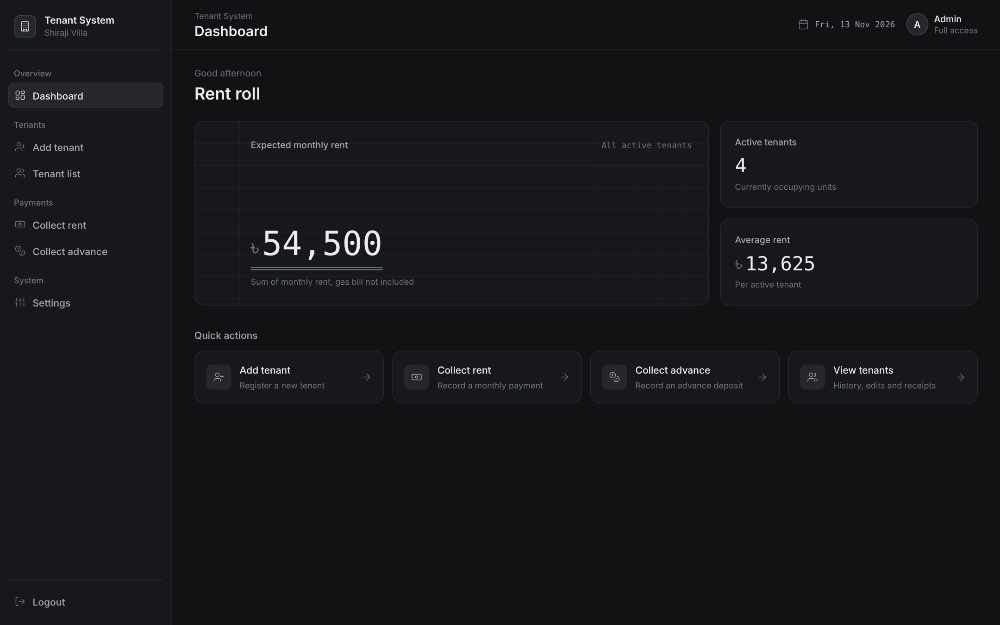

> Screenshots use sample tenants and figures, not real records.

---

## Contents

- [Features](#features)
- [Screenshots](#screenshots)
- [How it works](#how-it-works)
- [Tech stack](#tech-stack)
- [Project structure](#project-structure)
- [Data model](#data-model)
- [Getting started](#getting-started)
- [Deployment](#deployment)
- [Configuration notes](#configuration-notes)
- [License](#license)

---

## Features

**Dashboard**
- Number of active tenants, expected monthly rent and average rent per tenant
- Quick actions for the four most common tasks

**Tenants**
- Register tenants with name, phone, email, NID, monthly rent and prepaid meter number
- Search by name, phone or NID
- Edit tenant details, or deactivate and reactivate a tenant without losing their history
- Payment history per tenant, combining rent and advance records with the newest first

**Payments**
- Record monthly rent with the rent month, paid amount and due amount
- Optional gas bill per payment, ৳1,080 by default
- Record advance or security deposits, with their own due tracking
- Pay off an outstanding due later from the history view; the record updates in place
- Every payment gets an invoice number automatically: `INV-YYYY-XXXX` for rent and `ADV-YYYY-XXXX` for advances

**Receipts**
- One-click printing to an 80mm thermal POS printer
- Each printed receipt carries a QR code linking to a public verification page
- The verification page (`receipt.html`) shows the paid amount, any due, and the building's prepaid meter codes

**Access**
- Admin sign-in with Firebase email and password
- Guest mode signs in anonymously and shows demo data; saving and editing are disabled
- Settings let you change the property name printed on every invoice

**Interface**
- Dark graphite "rent ledger" theme with amounts set in a monospace face
- Responsive layout: the sidebar becomes a slide-out menu on tablets and phones
- Toast notifications replace browser alerts, and there are keyboard-friendly focus states

---

## Screenshots

### Sign in
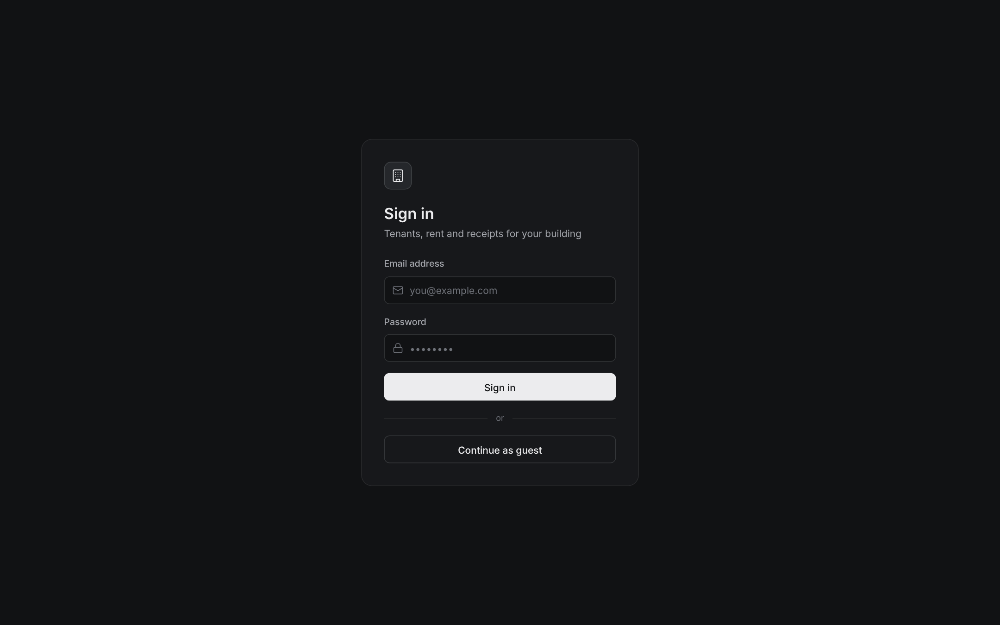

### Tenant list
Search, view a tenant's history, edit details, or switch their status.

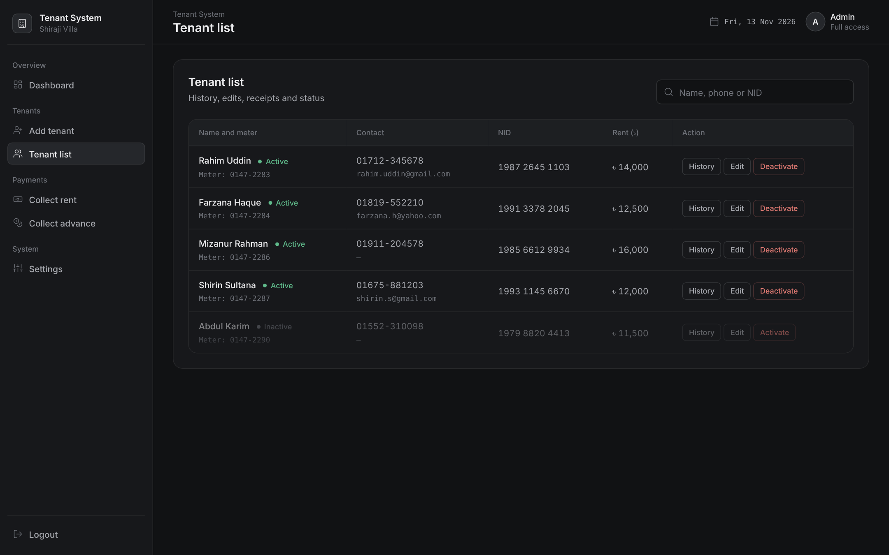

### Payment history
Rent and advance records for one tenant. Rows with a due amount show a **Pay Due** button.

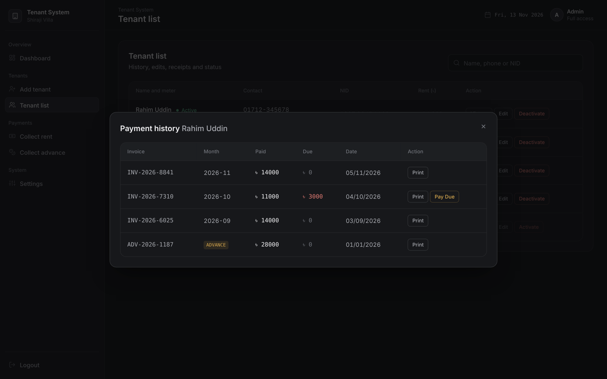

### Collect rent
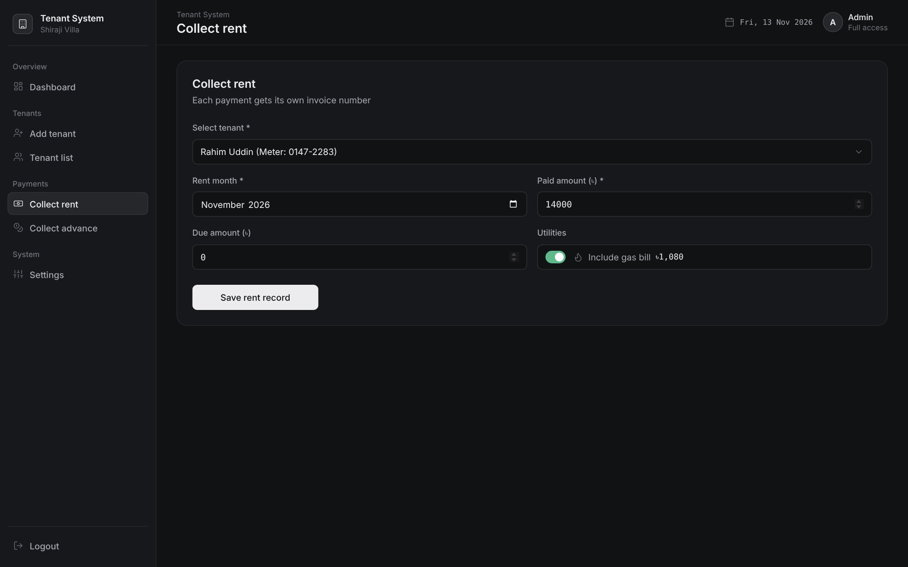

### Add tenant
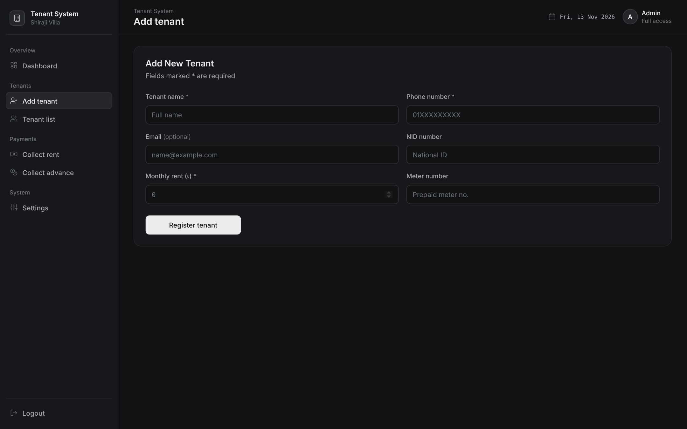

### Settings
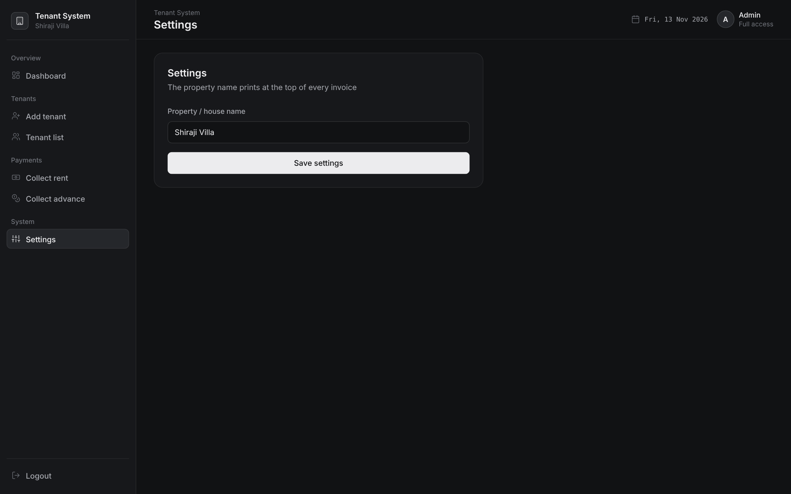

### Receipts

<table>
<tr>
<td width="50%" valign="top">

**Thermal print (80mm)**
The printed copy also includes a QR code that links to the verification page.

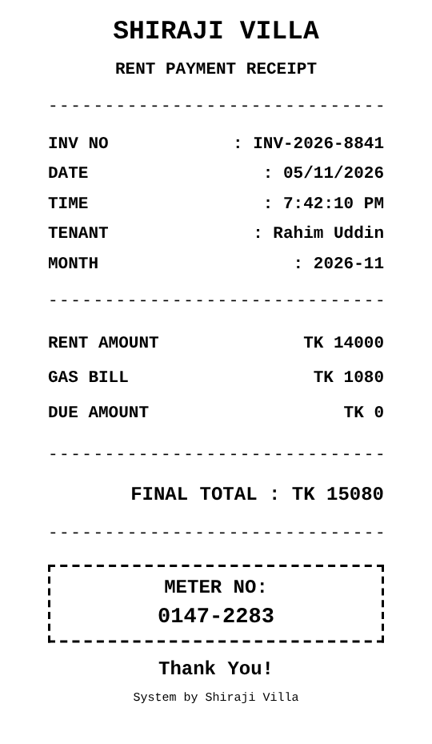

</td>
<td width="50%" valign="top">

**Public verification page**
What a tenant sees after scanning the QR code.

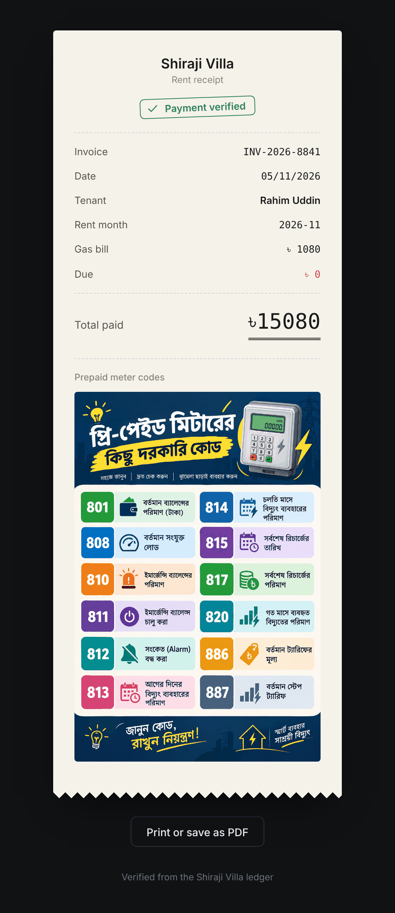

</td>
</tr>
</table>

### Mobile

<p>
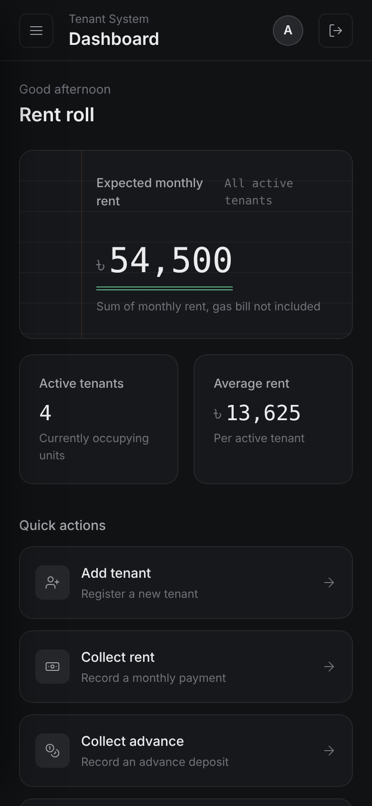
&nbsp;&nbsp;
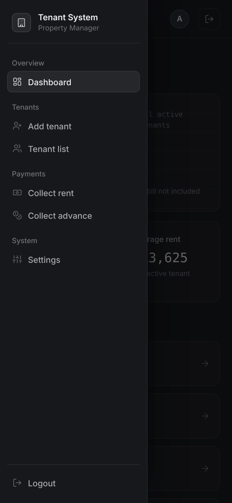
</p>

---

## How it works

```
Admin records a payment ──► Firestore (rent_records / advance_records)
        │
        ▼
Print receipt ──► thermal printer
        │           └─ QR code → /receipt.html?inv=INV-2026-8841
        ▼
Tenant scans QR ──► receipt.js signs in anonymously
                    └─ looks up the invoice ID → shows the verified receipt
```

1. **Collect rent:** pick a tenant, a month, the paid amount and any due. You can include or leave out the gas bill. The app saves the record and shows the new invoice number.
2. **Print:** open the tenant's payment history and click **Print**. This fills the hidden thermal layout in `index.html` and opens the print dialog. The final total is the paid amount plus the gas bill.
3. **Verify:** the QR code points to `receipt.html?inv=<invoice>`. That page searches `rent_records` first, then `advance_records`, and renders the matching receipt.
4. **Settle dues:** in the history view, **Pay Due** opens a small form. The payment is added to the paid amount and subtracted from the due. It can't exceed the amount still due.

---

## Tech stack

| Layer | Technology |
|---|---|
| Frontend | HTML5, CSS3 (custom properties, Grid, Flexbox), vanilla JavaScript (ES modules) |
| Database | Firebase Cloud Firestore |
| Auth | Firebase Authentication (email/password and anonymous) |
| QR codes | [goqr.me API](https://goqr.me/api/) (`api.qrserver.com`) |
| Fonts | Plus Jakarta Sans and JetBrains Mono (Google Fonts) |
| Hosting | Vercel, deploying automatically from GitHub |

There's no build step or package manager; the Firebase SDK v10.8.1 is loaded from the gstatic CDN.

---

## Project structure

```
tenant_record/
├── index.html        # Admin app: login, dashboard, forms, modals, thermal print layout
├── style.css         # Ledger theme, responsive rules, print styles
├── ui.js             # UI layer: toasts, nav state, mobile menu, modal close, number formatting
├── app.js            # Firebase logic: auth, tenants, rent/advance records, dues, printing
├── receipt.html      # Public invoice verification page (paper-slip design)
├── receipt.js        # Looks up an invoice by ?inv= and fills the receipt
├── meter-codes.png   # Prepaid meter code reference shown on the receipt page
└── screenshots/      # Images used in this README
```

---

## Data model

Firestore collections used by the app:

**`tenants`**
| Field | Type | Notes |
|---|---|---|
| `name` | string | |
| `phone` | string | |
| `email` | string | optional |
| `nid` | string | national ID |
| `rent` | number | monthly rent in ৳ |
| `meter` | string | prepaid meter number |
| `status` | string | `active` or `inactive` |
| `registrationDate` | string | locale date |

**`rent_records`**
| Field | Type | Notes |
|---|---|---|
| `tenantId` | string | ID of the tenant document |
| `invoiceId` | string | `INV-YYYY-XXXX` |
| `rentMonth` | string | `YYYY-MM` |
| `paidAmount` | number | |
| `gasBill` | number | `1080` or `0` |
| `dueAmount` | number | |
| `paymentDate` | string | locale date |
| `timestamp` | timestamp | used to sort history |

**`advance_records`**: `tenantId`, `invoiceId` (`ADV-YYYY-XXXX`), `advanceAmount`, `dueAmount`, `paymentDate`, `timestamp`

**`settings/config`**: `propertyName`, the name printed on invoices

---

## Getting started

### 1. Clone

```bash
git clone https://github.com/fuad-dv/tenant_record.git
cd tenant_record
```

### 2. Connect Firebase

1. Create a project in the [Firebase console](https://console.firebase.google.com/).
2. Turn on **Authentication**, with both the **Email/Password** and **Anonymous** providers.
3. Create a **Cloud Firestore** database.
4. Add an admin user under Authentication → Users.
5. Replace the `firebaseConfig` object in **both** `app.js` and `receipt.js` with your project's web config.

### 3. Run locally

The scripts are ES modules, so serve the folder over HTTP instead of opening the file directly:

```bash
# any static server works
npx serve .
# or
python3 -m http.server 8000
```

Then open `http://localhost:8000`.

### 4. Security rules

The web config in the client code is public by design; the Firestore rules are what protect the data. Here is a starting point that lets the admin read and write while anonymous visitors (guests and the receipt page) can only read:

```js
rules_version = '2';
service cloud.firestore {
  match /databases/{database}/documents {
    function isAdmin() {
      return request.auth != null && request.auth.token.firebase.sign_in_provider == 'password';
    }
    match /{document=**} {
      allow read: if request.auth != null;
      allow write: if isAdmin();
    }
  }
}
```

Tighten the read rule further if anonymous users shouldn't see tenant details. The receipt page only needs to read `rent_records`, `advance_records` and the matching tenant's `name`.

---

## Deployment

The project is static, so any static host works. Production runs on **Vercel**:

1. Import the GitHub repo into Vercel. No framework preset or build command is needed.
2. Every push to the main branch redeploys automatically.
3. If your domain differs from `tenant-record-three.vercel.app`, update the QR target URL in `app.js` (inside `printInvoice`):

```js
const qrUrl = `https://tenant-record-three.vercel.app/receipt.html?inv=${invoiceNo}`;
```

---

## Configuration notes

| What | Where |
|---|---|
| Property name on invoices | **Settings** page in the app (`settings/config` in Firestore) |
| Gas bill amount (৳1,080) | `app.js` (rent form submit and history fallback), `receipt.js`, and the label in `index.html` |
| QR verification URL | `printInvoice()` in `app.js` |
| Thermal receipt width | `.pos-receipt` in `style.css` (300px, sized for 80mm paper) |
| Prepaid meter codes image | replace `meter-codes.png` |

### Printing tips
- In the print dialog, choose your thermal printer and set margins to **None**.
- Turn off the browser's headers and footers so they don't print on the slip.

---

## License

**Proprietary. All rights reserved.**

This project is in active development. The source code is not licensed for public distribution, modification or commercial use. Contact the repository owner for permission.
